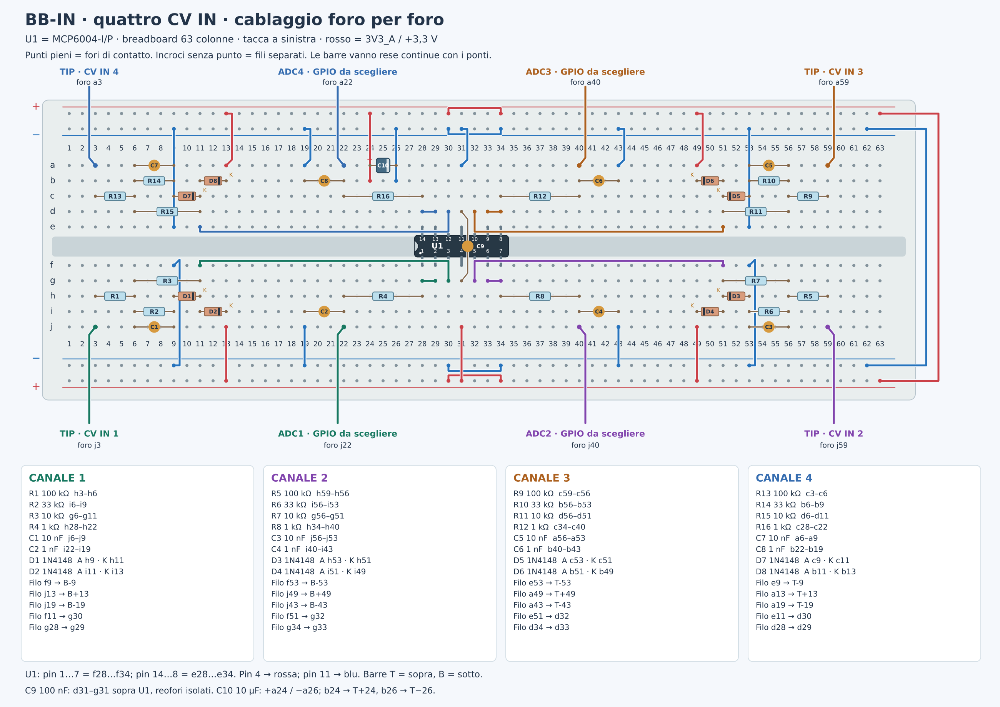

# Quattro CV IN — proposta

[SVG](breadboard.svg) · [Schema elettrico](schema.svg).
MCP6004 a 3,3 V, ingressi unipolari 0–10 V, sleeve a GND comune.
Pin Daisy ancora da scegliere: ADC1–4 nel disegno sono punti di uscita del circuito.

Componenti e fori sono nel disegno. Ponticellare le barre interrotte.
Prima di collegare Daisy: IN 0/5/10 V → ADC circa 0/1,24/2,48 V.
Non applicare CV direttamente ai GPIO né al circuito spento.
