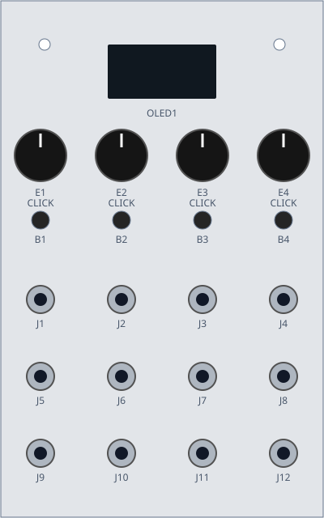

# Pannello ADLFO



Riferimento fisico corrente: quattro encoder cliccabili, quattro tasti,
dodici jack disposti in tre righe e quattro colonne, un OLED e due fori superiori.
Il front panel è già cablato dall'utente.

Le coordinate sono **relative**, non misure di foratura. Dimensioni effettive,
interassi e ingombri vanno rilevati sul pannello reale prima di produrre altre parti.

## Identificativi e progetto corrente

Guardando il pannello dal davanti, colonne da sinistra a destra:

| Colonna | Encoder | Tasto | Alto: TRIG IN | Centro: CV IN | Basso: OUT |
| --- | --- | --- | --- | --- | --- |
| C1 | E1 | B1 | J1 | J5 | J9 |
| C2 | E2 | B2 | J2 | J6 | J10 |
| C3 | E3 | B3 | J3 | J7 | J11 |
| C4 | E4 | B4 | J4 | J8 | J12 |

L'assegnazione delle righe è la proposta elettrica corrente descritta in
[SCHEMI.md](../SCHEMI.md); non certifica la destinazione attuale dei cavetti
né il supporto dei quattro canali nel firmware.
I click E1_SW–E4_SW sono distinti dai quattro tasti B1–B4.

## File

- [layout.json](layout.json): geometria, inventario e identificativi fisici.
- [functions.json](functions.json): assegnazione elettrica proposta, ancora da implementare.
- [panel.svg](panel.svg): disegno illustrativo con gli ID di posizione.
- [render.py](render.py): generatore SVG, legge soltanto la geometria.

Per rigenerare il disegno dalla radice del progetto:

```sh
python3 wiring/pannello/render.py
```

Le funzioni effettive di encoder e tasti sono in [CONTROLLI.md](../CONTROLLI.md).
Per lo stato del montaggio e la sequenza di lavoro vedere [wiring/README.md](../README.md).
