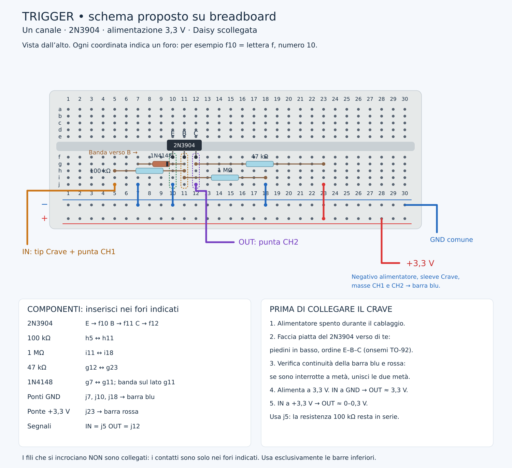

# TRIG IN — proposta

[SVG](trigger_breadboard.svg). Un circuito per canale, alimentato a 3,3 V.
IN = j5; OUT = j12; sleeve a GND. GPIO Daisy ancora da scegliere.
Componenti e fori sono nel disegno; controllare E/B/C sul proprio transistor.

Prima del collegamento alla Daisy: IN a 0 V → OUT circa 3,3 V;
IN a 3,3 V → OUT circa 0–0,3 V. Il circuito inverte il segnale.
